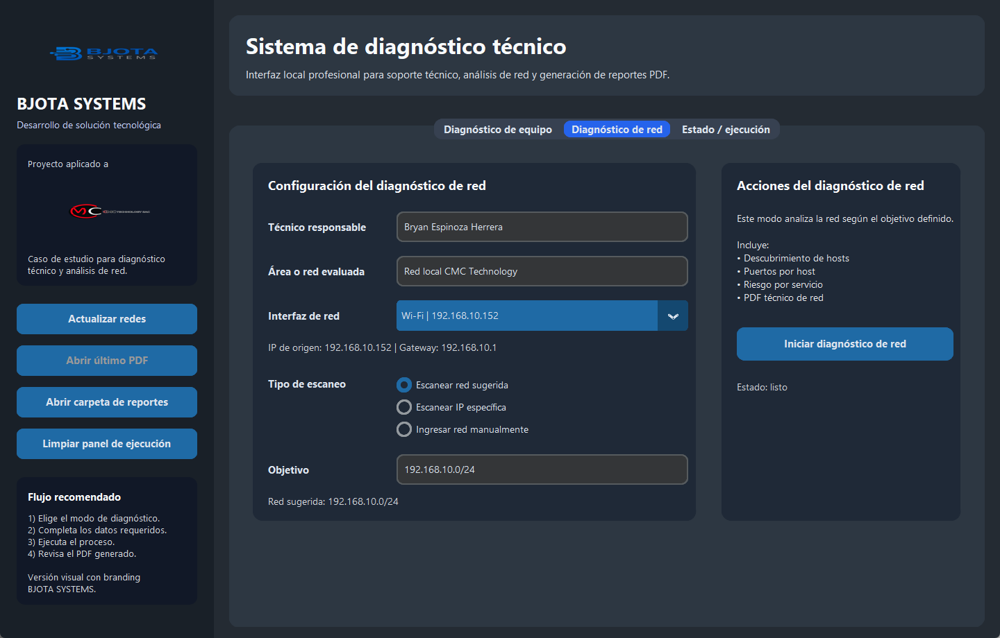
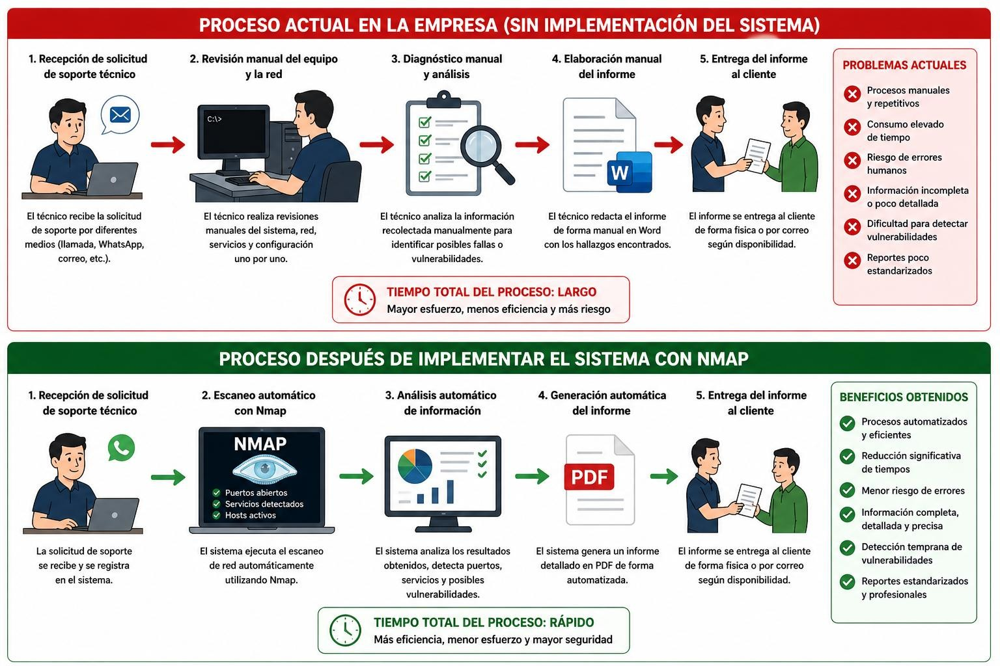
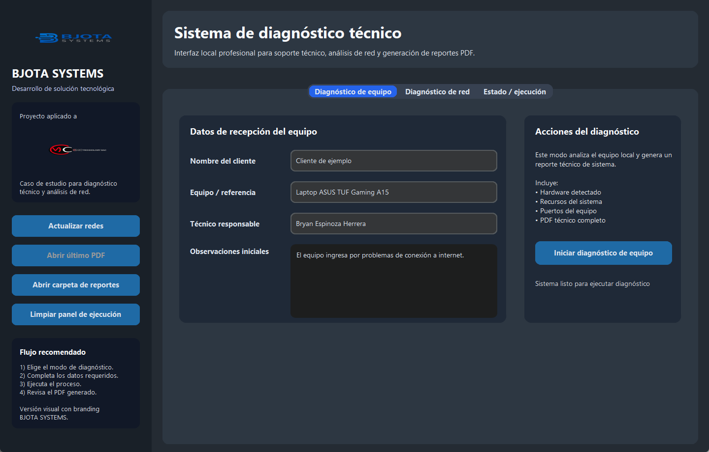
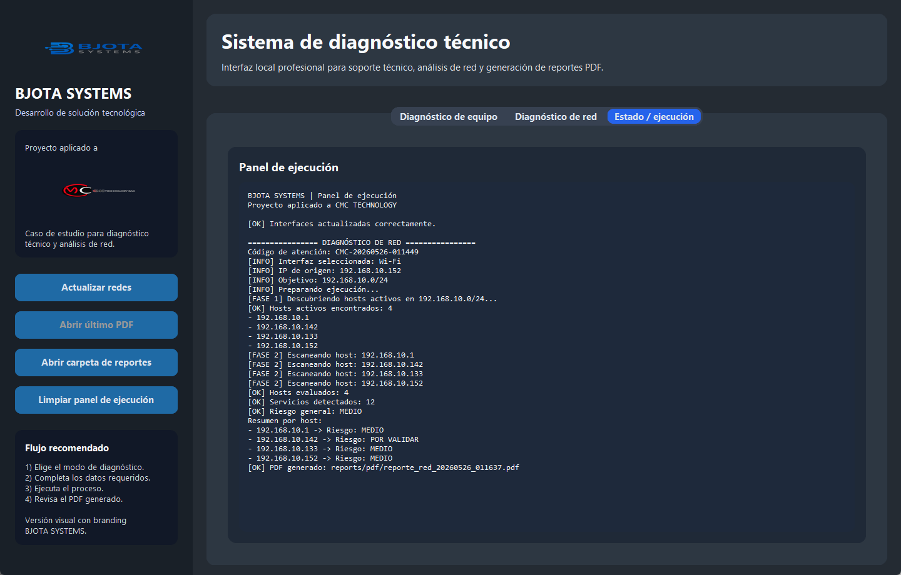
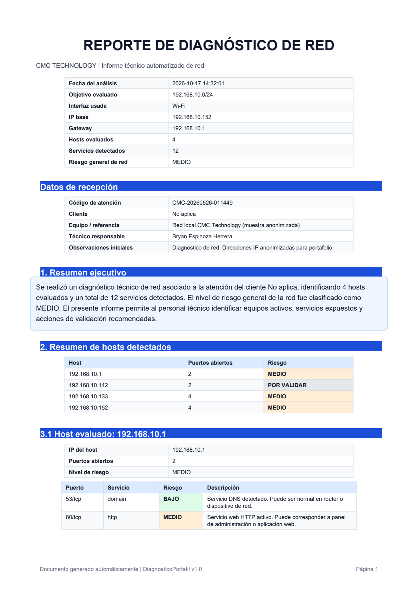
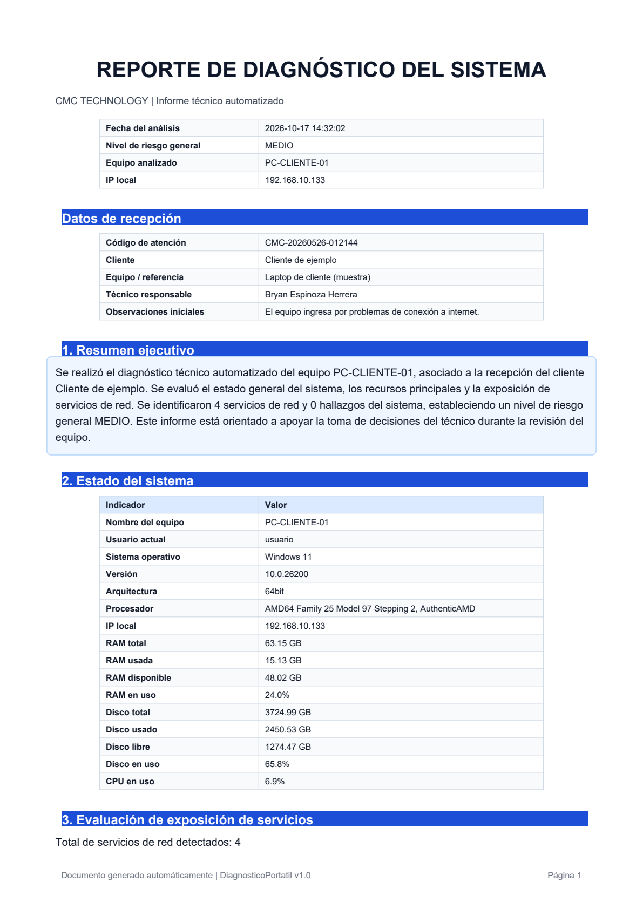
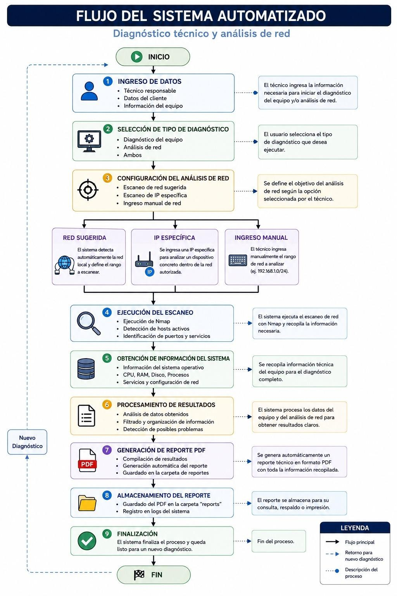

# Sistema automatizado de diagnóstico técnico y análisis de vulnerabilidades en redes

**Proyecto de innovación SENATI 2026 · Aplicado en CMC Technology S.A.C. (Trujillo, Perú)**

Programa para computadora hecho en **Python** que usa **Nmap** (una herramienta gratuita que revisa qué equipos hay en una red y qué tienen abierto). Hace solo lo que antes el técnico de soporte hacía a mano: encuentra los equipos conectados, revisa qué "puertas de entrada" (puertos) tiene abierta cada uno, dice qué tan riesgoso es y entrega un **reporte PDF** listo para el cliente.

📄 **[Ver el caso de estudio completo (PDF)](docs/caso-de-estudio.pdf)**

---

## El problema en la empresa

CMC Technology vende equipos informáticos y da soporte técnico a usuarios, emprendedores y pequeñas empresas. Durante mis prácticas en el área de soporte vi cuatro problemas:

| Problema | Qué pasaba |
|---|---|
| **No se revisaba el estado de las computadoras** (procesador, memoria, disco, red) | La lentitud o el disco lleno se notaban recién cuando el cliente ya tenía el problema |
| **No se revisaba la red antes de que fallara** | Nadie sabía qué equipos estaban conectados ni qué tenía abierto cada uno |
| **Cada técnico revisaba a su manera** | Resultados distintos, atenciones más largas y ningún procedimiento igual para todos |
| **No había reportes ordenados** | Los hallazgos se contaban de palabra o en documentos de Word hechos a mano |

**Causa principal:** faltaban herramientas que hicieran la revisión solas, pasos iguales para todos y reglas de seguridad. Por eso se trabajaba "apagando incendios" y sin ver bien qué pasaba en los equipos.

## La solución

El programa tiene cuatro partes:

| Parte | Qué hace |
|---|---|
| **Revisión de la computadora** | Muestra el sistema operativo, el procesador, cuánto se usa la memoria y el disco, y la dirección IP. Avisa si el equipo está saturado, si el disco está casi lleno o si tiene una IP APIPA (una dirección 169.254.x.x que aparece cuando el equipo no recibió IP del router, es decir, falló el DHCP) |
| **Revisión de la red** | Con Nmap primero busca qué equipos están encendidos en la red (`-sn`, descubrir equipos) y luego revisa cada uno. Hay tres niveles: rápido, básico (`-sV`, detecta qué programa y versión hay detrás de cada puerto) y completo |
| **Análisis** | Lee lo que encontró Nmap y marca cada servicio como riesgo **ALTO / MEDIO / BAJO / POR VALIDAR**, con una recomendación |
| **Reporte** | Crea un PDF con un código de atención, un resumen, una tabla por equipo con colores según el riesgo, recomendaciones y una conclusión |

Además:
- **3 formas de elegir qué revisar:** la red que el programa sugiere solo, una IP específica o un rango de IPs que escribe el técnico.
- **Se lleva en una USB:** trae Nmap incluido, así que no hay que instalar nada en la computadora del cliente.
- **No se congela:** mientras revisa la red, la ventana sigue respondiendo y muestra el avance en vivo.

### Cómo clasifica el riesgo (resumen)

Un **puerto** es como una puerta de entrada a la computadora, y el **servicio** es el programa que atiende en esa puerta.

| Servicio | Riesgo | Recomendación |
|---|---|---|
| Telnet (23, control remoto sin cifrar), RDP (3389, escritorio remoto de Windows), VNC (5900, otro tipo de escritorio remoto), bases de datos (3306/5432/1433) | 🔴 ALTO | Apagarlos o permitir la entrada solo a IPs autorizadas |
| SMB (445, carpetas e impresoras compartidas de Windows), NetBIOS (139) y RPC (135), servicios de Windows para compartir en red, HTTP (80, páginas web sin cifrar), FTP (21, envío de archivos sin cifrar) | 🟠 MEDIO | Ver si de verdad se usan, revisar qué carpetas se comparten y el firewall (el filtro que decide qué conexiones entran) |
| HTTPS (443, páginas web cifradas), SSH (22, control remoto cifrado), DNS (53, traduce nombres de páginas a direcciones) | 🟢 BAJO | Suelen ser normales; revisar quién puede entrar |
| Puertos poco comunes o servicios que Nmap no pudo identificar | ⚪ POR VALIDAR | Preguntar al cliente qué programa los usa |

## Capturas

| Diagnóstico de equipo | Panel de ejecución |
|---|---|
|  |  |

## Prueba en la red de la empresa

Se probó el 26/05/2026 en la red local de CMC Technology (las IPs están anonimizadas, es decir, cambiadas para no mostrar las reales):

| Equipo (IP) | Tipo | Servicios abiertos | Riesgo |
|---|---|---|---|
| 192.168.10.1 | Router | DNS (53), HTTP (80) | 🟠 MEDIO |
| 192.168.10.142 | Dispositivo móvil | 49152, 62078 (Nmap no pudo identificar el servicio) | ⚪ POR VALIDAR |
| 192.168.10.133 | PC Windows | RPC, NetBIOS, SMB, 7070 | 🟠 MEDIO |
| 192.168.10.152 | PC Windows | RPC, NetBIOS, SMB, 7070 | 🟠 MEDIO |

**Resultado:** 4 equipos (hosts), 12 servicios encontrados y riesgo general **MEDIO**. El reporte PDF salió solo, sin que nadie lo redactara.

## Reportes de ejemplo

| Reporte de red | Reporte de equipo |
|---|---|
|  |  |

## Tecnologías

- **Python:** el lenguaje en que está hecho el programa.
- **Nmap:** la herramienta que revisa la red, los equipos y sus puertos.
- **CustomTkinter:** para la ventana del programa (interfaz gráfica de escritorio, con botones y formularios).
- **ReportLab:** para crear los reportes en PDF.

## Próximos pasos

- Guardar el historial de todas las atenciones en un solo lugar
- Revisar la red cada cierto tiempo y avisar si aparece un servicio de riesgo alto
- Una página web para ver los reportes junto con la lista de equipos de la empresa
- Comparar las versiones encontradas con listas públicas de fallas de seguridad conocidas

## Mi rol

Me encargué del proyecto de principio a fin: vi el problema en el área de soporte, pensé la solución y desarrollé el programa con apoyo de asistentes de IA. También hice las pruebas en la red de la empresa y la documentación, que presenté como proyecto de innovación en SENATI (asesor: Luis Cristofer Mostacero Pérez).

---

> ⚖️ **Uso ético:** la herramienta se usó solo en redes y equipos con permiso de la empresa. Las IPs de este repositorio están anonimizadas y no se muestran nombres de equipos ni de usuarios.
>
> 🔒 **Código fuente:** este repositorio es una vitrina del proyecto. El código no se publica, pero puedo mostrarlo y hacer una demostración en una entrevista.

**Bryan Jeremy Espinoza Herrera** · Profesional Técnico en Ingeniería de Ciberseguridad · Trujillo, Perú
